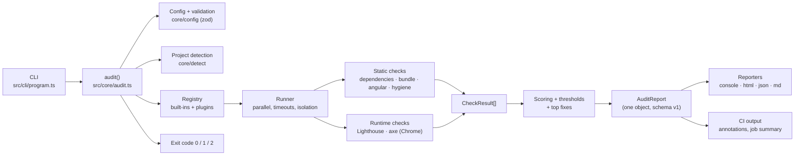

# Learning ng-health

A study guide for explaining this project in interviews, to the team and to clients. Every
section points at real files, so you can open the code while you read.

**Teaching progress:** Phase 1 ✓ · Phase 2 ✓ · Phase 3 ▸ in progress · Phases 4–8 to review

---

## 1. Architecture overview

**In words:** the CLI parses flags and calls `audit()`. `audit()` loads and validates the
config, detects the project setup, and builds the list of checks: built-ins plus any plugins
from the config. The **runner** executes them in parallel, each with its own timeout, so one
failure can't break the others. Each check returns findings and a 0–100 score.

Scores are combined into category scores and an overall score, thresholds are evaluated, and
the most impactful fixes are ranked. Everything goes into **one report object**. The reporters
are just different views of that object. The exit code tells CI whether the quality gate
passed.

The key idea: **the core knows nothing about specific checks.** It only knows the `Check`
interface. That's what makes the tool extensible.

---

## 2. Key concepts glossary

| Concept                     | In one line                                                                                      | Where in our code                                      |
| --------------------------- | ------------------------------------------------------------------------------------------------ | ------------------------------------------------------ |
| **CLI**                     | A command-line program; ours parses commands/flags with commander.                               | `src/cli/program.ts`                                   |
| **Exit code**               | The number a process returns; CI uses it to pass/fail a job (0 ok, 1 gate failed, 2 tool error). | `src/core/errors.ts` (`ExitCode`)                      |
| **Schema validation**       | Checking untrusted input (config files) against a declared shape, with readable errors.          | `src/core/config/schema.ts` (zod)                      |
| **JSON Schema**             | A standard, language-neutral description of a JSON shape; editors use it for autocomplete.       | `schema/config.schema.json`, `schema/report.v1.json`   |
| **JSONC**                   | JSON with comments/trailing commas; `angular.json` and `tsconfig.json` often use it.             | `src/core/fs.ts` (`stripJsonc`)                        |
| **Plugin architecture**     | The core runs anything that matches an interface; features are added without editing the core.   | `src/core/types.ts` (`Check`), `src/core/plugins.ts`   |
| **Registry**                | The list of available plugins, plus the logic that selects which ones run.                       | `src/core/registry.ts`                                 |
| **Fault isolation**         | One component failing (a check throwing or hanging) doesn't take down the whole run.             | `src/core/runner.ts` (`runCheck`)                      |
| **AbortSignal**             | A standard way to tell async work "stop now"; we fire it on check timeout.                       | `runner.ts` (`withTimeout`), `exec.ts`                 |
| **Bounded concurrency**     | Run N things in parallel at most (a worker pool), not all at once.                               | `runner.ts` (`runChecks`)                              |
| **Weighted average**        | Each item contributes proportionally to its weight; used for category/overall scores.            | `src/core/scoring.ts`                                  |
| **AST**                     | Abstract Syntax Tree: code parsed into a tree of nodes you can query, instead of regex on text.  | `src/checks/angular/analysis.ts`                       |
| **ts-morph**                | A friendly wrapper around the TypeScript compiler API for navigating ASTs.                       | `analysis.ts`                                          |
| **Angular template parser** | `@angular/compiler`'s `parseTemplate`, the same parser Angular uses to understand templates.     | `src/checks/angular/template.ts`                       |
| **Visitor pattern**         | Walk a tree by overriding "visit this node type" methods.                                        | `template.ts` (`TemplateVisitor`, `ExpressionVisitor`) |
| **Tree-shaking / bundles**  | The build removes unused code; "initial" JS loads first, "lazy" chunks load on demand.           | `src/checks/bundle/`                                   |
| **Budgets**                 | Size limits in `angular.json`; we compare the build output against them.                         | `bundle/budgets.ts`, `bundle/size.ts`                  |
| **Lighthouse**              | Google's page audit (performance, best practices, SEO, accessibility) run in Chrome.             | `src/checks/performance/lighthouse.ts`                 |
| **axe-core**                | The industry-standard engine for automated WCAG accessibility testing.                           | `src/checks/accessibility/axe.ts`                      |
| **CDP**                     | Chrome DevTools Protocol; lets Playwright attach to the same Chrome Lighthouse uses.             | `src/runtime/session.ts`                               |
| **Fingerprint**             | A stable hash identifying "the same finding" across runs (no line numbers).                      | `src/core/fingerprint.ts`                              |
| **Baseline / trend**        | Compare a run with a previous JSON report to show deltas and new/resolved findings.              | `src/core/baseline.ts`                                 |
| **Quality gate**            | Thresholds that fail CI (exit 1) when quality drops below a bar.                                 | `src/core/thresholds.ts`                               |
| **Snapshot test**           | Store expected output once; later runs must match it exactly.                                    | `test/integration/__snapshots__/`                      |
| **Fixture**                 | A small, fake project with known contents used as test input.                                    | `test/fixtures/healthy`, `unhealthy`                   |

---

## 3. Decisions log

| #   | Decision                                                               | Why                                                                                                                                   | Alternatives considered                                                      |
| --- | ---------------------------------------------------------------------- | ------------------------------------------------------------------------------------------------------------------------------------- | ---------------------------------------------------------------------------- |
| 1   | **commander** for the CLI                                              | Mature, typed, handles repeatable and comma-separated options and subcommands.                                                        | citty (lighter, less battle-tested for variadic flags), yargs (heavier API). |
| 2   | **zod** for config validation                                          | One source of truth: runtime validation, TypeScript types _and_ the published JSON Schema come from the same definition.              | ajv + hand-written JSON Schema (types drift), no validation (bad UX).        |
| 3   | **Exit codes 0/1/2**                                                   | CI needs to tell "your code failed the gate" (1) apart from "the tool broke" (2).                                                     | 0/1 only (can't tell real failures from misconfiguration).                   |
| 4   | **Diagnostics on stderr, reports on stdout**                           | `ng-health … > summary.md` captures only the report; logs don't pollute it.                                                           | Everything on stdout (breaks piping).                                        |
| 5   | **Plugin architecture** (`Check` interface + registry)                 | New checks need zero core changes; teams can ship private checks.                                                                     | One big `if`/`switch` per check type (every new check edits the core).       |
| 6   | **Runner isolates failures** (timeout + try/catch + output validation) | A buggy plugin or a hung `npm audit` must not crash a 5-minute audit.                                                                 | Let errors propagate (one bad check kills the run).                          |
| 7   | **Ratio-based scores** for "N of M" checks                             | 30 components without OnPush in a big app shouldn't score 0 when 270 have it.                                                         | Fixed penalties per finding only (punishes large codebases).                 |
| 8   | **Skipped/errored checks leave the score** (weights renormalised)      | "Chrome missing" shouldn't make performance count as 0.                                                                               | Count them as 0 (unfair) or 100 (hides problems).                            |
| 9   | **ts-morph + @angular/compiler** for Angular checks                    | Real parsing understands code structure; the official template parser handles `@if`, pipes and `*ngIf` exactly like Angular.          | Regex (false positives on comments/strings), raw TS compiler API (verbose).  |
| 10  | **One shared parse** (`ctx.shared`) for all 8 Angular checks           | Parse the project once and query it 8 times; much faster on big codebases.                                                            | Each check re-parses (8× the work).                                          |
| 11  | **Version-aware rules**                                                | Angular 22 made OnPush and `strictTemplates` the defaults, and TS 6 made `strict` the default. Version-blind rules give wrong advice. | One rule for all versions (we hit and fixed exactly this bug).               |
| 12  | **One Chrome per audit, shared via CDP**                               | Lighthouse and axe reuse one browser; the login session carries over to both.                                                         | Separate browsers (slower; login lost between tools).                        |
| 13  | **Runtime libraries are optional and lazy-loaded**                     | `npx ng-health` stays fast; without Chrome the runtime checks skip with a reason.                                                     | Hard dependencies (heavy install, crash without Chrome).                     |
| 14  | **One report object, many reporters**                                  | HTML, JSON, Markdown and console can't disagree; adding a format is easy.                                                             | Each format computes its own data (inconsistent numbers).                    |
| 15  | **Self-contained HTML** (inline CSS/JS, escaped content)               | Works offline, safe to email to clients, prints to PDF; no CDN calls leak data.                                                       | A framework/CDN-based page (network, privacy and XSS risks).                 |
| 16  | **Fingerprints without line numbers**                                  | Moving code shouldn't make findings look "new" in trends.                                                                             | Fingerprint by file+line (noisy diffs).                                      |
| 17  | **Fixture projects + exact assertions**                                | Tests prove _specific_ findings appear at specific lines, not just "something was found".                                             | Mocks only (don't catch real parsing issues).                                |
| 18  | **TypeScript judged against Angular's range**                          | Advising "upgrade TS to 7" on Angular 21 is wrong; Angular pins supported TS versions.                                                | Compare with latest (the bug we found on a real project).                    |
| 19  | **Signal handling (SIGINT/SIGTERM)**                                   | A cancelled CI job must not leave headless Chrome running.                                                                            | Rely on chrome-launcher (only handles SIGINT; we saw orphans).               |

### Packaging as a CLI + library (ng-health)

| #   | Decision                                                                                | Why                                                                                                                                 | Alternatives considered                                                    |
| --- | --------------------------------------------------------------------------------------- | ----------------------------------------------------------------------------------------------------------------------------------- | -------------------------------------------------------------------------- |
| 20  | **Pure library core, thin CLI** (`core/audit.ts` `runAudit` vs `cli/commands/audit.ts`) | Library users embed it in their own tools. A library that prints, writes files or calls `process.exit` would hijack their process.  | One function that does everything (unusable as a library)                  |
| 21  | **Typed errors with `code`** (`ConfigError`, `CheckError`, `ProjectError`)              | Callers branch with `instanceof` or `err.code`; the CLI maps them all to exit 2.                                                    | Exit codes inside the library (kills the host process)                     |
| 22  | **`AbortSignal` for cancellation**                                                      | The standard web/Node API. The CLI turns SIGINT/SIGTERM into an abort; library users get cancellation for free. No global state.    | A process-wide shutdown registry (global state inside a library)           |
| 23  | **jiti for `.ts` configs and plugins**                                                  | Users write `ng-health.config.ts` and TS checks without a build step; it resolves `.js` import specifiers to `.ts`.                 | Requiring users to compile first; `tsx` loader hooks (global side effects) |
| 24  | **Changesets for releases**                                                             | Each PR declares its own semver bump and changelog line; a bot PR batches them and publishing is automatic, with provenance.        | semantic-release (infers versions from commit messages; harder to review)  |
| 25  | **`npm run smoke` on the packed tarball**                                               | Unit tests use the source; only installing the real tarball catches missing files, wrong `exports`, a lost shebang or broken types. | Trusting `npm pack --dry-run` alone                                        |

---

## 4. Interview Q&A

### Phase 1: CLI skeleton

**Q: Why three exit codes instead of pass/fail?**
A: CI has to react differently. Exit 1 means "the code didn't meet the quality bar", which is a
real failure developers should fix. Exit 2 means "the tool couldn't run", for example a bad
config or a non-Angular folder, which is a setup problem. Collapsing them hides
misconfiguration as quality failures.

**Q: How do you validate the config, and why zod?**
A: The config file is user input, so it's validated before use. With zod I declare the shape
once and get runtime validation with precise errors (`thresholds.minOverallScore: must be ≤100`),
TypeScript types via `z.infer`, and a generated JSON Schema for editor autocomplete. Three
artefacts, one source of truth, so they can't drift apart.

**Q: How does it detect the project setup?**
A: It reads `angular.json` (allowing comments) for projects, builders, output paths and SSR
targets. It takes the Angular version from `node_modules/@angular/core`, falling back to the
range in `package.json`. The package manager comes from the `packageManager` field or the
lockfile, searching up the folder tree for monorepos.

### Phase 2: Check plugin architecture

**Q: How do you stop a third-party plugin from breaking your tool?**
A: Three layers in `src/core/runner.ts`:

- try/catch around `run()`
- a timeout via `Promise.race` plus an `AbortSignal`, so a hang can't stall the run
- zod validation of the returned data, so malformed output can't corrupt the report

Each failure is contained to that one check and reported as "errored".

**Q: Why dependency injection for checks?**
A: Checks receive `ctx.exec`, `ctx.readText` and similar instead of importing `child_process`
or `fs`. Tests inject fakes (recorded `npm audit` output) to stay fast, offline and
deterministic. The runner can also wrap `exec` per check to attach that check's timeout signal.

**Q: How is the overall score calculated, and what if Chrome is missing?**
A: A category score is the weighted mean of its completed checks. The overall score is the
weighted mean of the categories (defaults 20/15/20/15/15/15). Skipped or errored checks are
excluded and the remaining weights rescaled, so missing Chrome doesn't count performance as 0.

### Understanding checks (with model answers)

**Phase 1**

1. _Exit code 2: is the code unhealthy?_ No. The tool couldn't run (bad config, wrong folder,
   bad flag). Read the `✖` line on stderr. Only exit 1 means the quality gate failed.
2. _Why "Detected…" goes to stderr:_ `ng-health audit --ci > summary.md` must capture only the
   report, because it becomes the PR comment, and log lines would break it.
3. _Adding a config option:_ one place, the zod schema. Validation, `z.infer` types and the
   generated JSON Schema all follow, and tests catch a stale schema file or missing docs.

**Phase 2**

1. _A check that hangs:_ it times out (120 s default), is marked "errored", is left out of the
   score, and the audit continues. `Promise.race` stops the waiting; the `AbortSignal` kills the
   hung child process through `ctx.exec`.
2. _Why `ctx.exec`:_ tests inject recorded output (fast, offline, deterministic, edge cases on
   demand); at runtime each check's `exec` carries its timeout signal and the project folder.
3. _300 components, 30 without OnPush:_ penalties give 100 − 120 → 0; the ratio gives 90.
   Ratios make scores comparable across project sizes.

### Phase 3: Static checks

**Q: Why AST parsing instead of regex?**
A: Regex sees text; the AST sees structure. It tells a `subscribe()` inside an `@Component`
class with `takeUntilDestroyed` in its pipe apart from one in a comment, string or service.
That precision keeps false positives out of client reports.

**Q: How did you keep the Angular analysis fast?**
A: Syntax-only parsing in an in-memory ts-morph project (no type checker, no import
resolution), parsed once and shared by all 8 Angular checks via `ctx.shared`. The trade-off is
no type information, covered by targeted heuristics (signal properties recognized by their
initializer).

**Q: How do you avoid false positives?**
A: Real parsers, explicit exemptions for safe-by-design patterns (HttpClient, ActivatedRoute),
version awareness (Angular 22 defaults, TypeScript ranges), and validation on real projects. Three
wrong rules were found that way, and each became a regression test.

_(Phases 4–8: added as we review them.)_

---

## 5. How to explain this project

### 30 seconds

"I built **ng-health**, a Node/TypeScript CLI that audits Angular codebases and produces a
scored health report. It checks dependencies and vulnerabilities, bundle size against budgets,
Angular anti-patterns using real AST parsing, code hygiene, and runs Lighthouse and axe in Chrome
for performance and accessibility. Every check is a plugin, so new checks don't touch the core.
It outputs a client-ready HTML report, JSON for machines and a Markdown PR comment, and in CI it's
a quality gate that fails the build when scores or vulnerabilities cross configured thresholds."

### 2 minutes

"The problem: teams and clients ask 'how healthy is this Angular app?', and the answer is usually
a manual, inconsistent review. ng-health automates that.

Architecturally it's a **plugin system**. The core defines a `Check` interface: id, category, and
a `run()` that returns findings and a score. A runner executes checks in parallel with per-check
timeouts. If one crashes or hangs, it's marked 'errored' and the audit continues.

There are 19 built-in checks:

- **Dependency health:** Angular support status from real release dates, outdated packages and
  `npm audit`.
- **Bundle analysis:** parses esbuild stats and compares against `angular.json` budgets.
- **Eight Angular anti-patterns:** detected with ts-morph and Angular's own template parser, for
  example missing OnPush, method calls in templates and `subscribe()` without cleanup.
- **Hygiene:** strict TypeScript, ESLint, test ratio and coverage.
- **Runtime:** Lighthouse and axe in one shared headless Chrome, with a login hook for protected
  pages.

Scores roll up into weighted category and overall scores, and the highest-impact fixes are
ranked. Everything becomes one versioned report object rendered as HTML, JSON, Markdown or
console. In CI it posts a PR comment, adds inline annotations and fails on thresholds.

It's tested with two fixture Angular projects, one healthy and one with known issues, with exact
assertions, plus end-to-end tests in real Chrome. Running it on a real project caught a bug: it
advised a TypeScript version Angular doesn't support. I fixed that by judging TypeScript against
Angular's supported range."

### Deep dive (talking points, in order)

1. **Problem and users:** delivery teams (internal), presales (client reports), CI (gate).
   Constraints: local-only, no telemetry, extensible.
2. **CLI and config** (`src/cli`, `src/core/config`): commander; zod as the single source for
   validation, types and JSON Schema; exit-code contract; stderr vs stdout.
3. **Detection** (`src/core/detect`): `angular.json` (JSONC), version, package manager,
   workspace, SSR, Nx.
4. **Plugin architecture** (`core/types.ts`, `registry.ts`, `plugins.ts`): the `Check` contract,
   selection with `--only`/`--skip`/config, loading plugins by path or package.
5. **Runner** (`core/runner.ts`): worker pool, exclusive checks, `AbortSignal` timeouts, output
   validation, `skipCheck()`.
6. **Scoring** (`core/scoring.ts`, `top-fixes.ts`): derived vs ratio scores, renormalised
   weights, grades, impact ranking.
7. **Angular analysis** (`checks/angular/analysis.ts`, `template.ts`): one shared ts-morph parse,
   template visitors, heuristics (signals vs methods, HttpClient/ActivatedRoute exemptions),
   version-aware defaults.
8. **Bundle** (`checks/bundle`): build or reuse dist, initial vs lazy from the esbuild metafile,
   budgets, top modules.
9. **Runtime** (`runtime/`, `checks/performance`, `checks/accessibility`): chrome-launcher +
   Playwright over CDP, local static server with SPA fallback, login script, graceful skip,
   signal cleanup.
10. **Reports** (`core/report.ts`, `reporters/`): one object, versioned schema, self-contained
    escaped HTML, Markdown marker for sticky PR comments, baseline fingerprints.
11. **CI** (`ci/github.ts`, `examples/github-actions`): annotations, job summary, workflow with
    baseline from main.
12. **Testing** (`test/`): fixtures, exact findings, snapshot, schema validation, real-Chrome
    e2e, coverage thresholds, docs-drift tests.
13. **Lessons learned:** real-project testing found version-dependent bugs (Angular 22 defaults,
    TypeScript/Angular coupling) and a process leak; each became a regression test.
