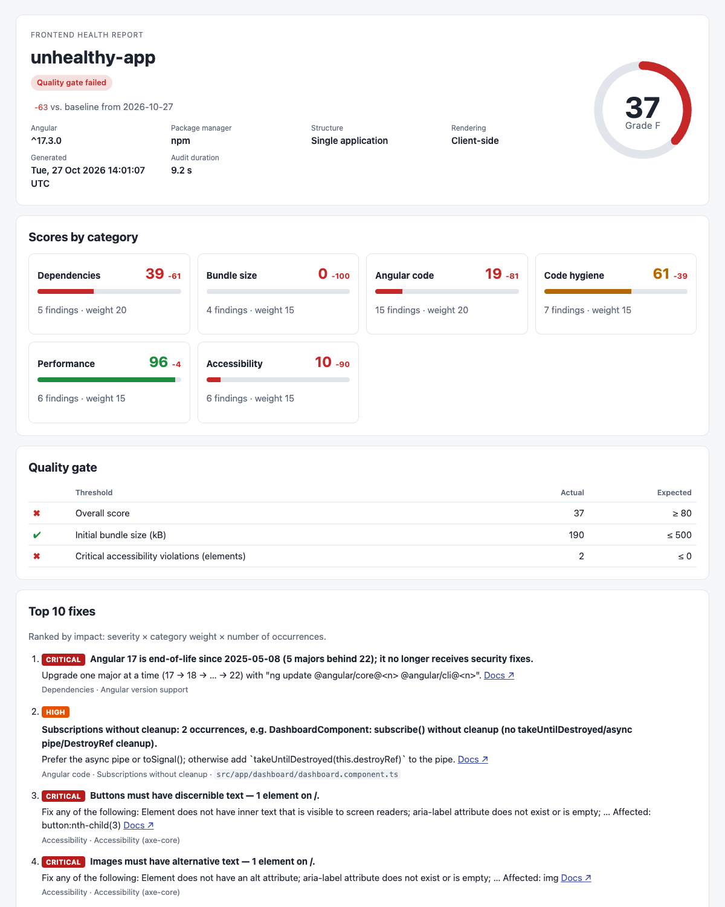

# fe-health

Audit an Angular codebase and get a **scored, actionable health report**: dependencies, bundle
size, Angular anti-patterns, code hygiene, Lighthouse performance and WCAG accessibility.

- **Delivery teams** run it on their projects to find the highest-impact fixes.
- **Presales** run it on a client codebase and hand over a print-ready HTML report.
- **CI** runs it as a quality gate on every pull request.

Everything runs locally. fe-health never uploads your code or reports and has no telemetry.
The only network traffic is to your npm registry (`npm outdated`/`audit`/`view`), and
`--offline` turns that off too.



## Contents

- [Install](#install)
- [Quick start](#quick-start)
- [Commands and flags](#commands-and-flags)
- [What it checks](#what-it-checks)
- [Scoring](#scoring)
- [Configuration](#configuration)
- [Reports](#reports)
- [CI setup](#ci-setup)
- [Writing a custom check](#writing-a-custom-check)
- [Troubleshooting](#troubleshooting)

## Install

Requires **Node.js 22 or later**.

```bash
# one-off, no install
npx fe-health audit

# or as a dev dependency of the project
npm install --save-dev fe-health
```

For an internal registry, point npm at it first (for example in `.npmrc`:
`registry=https://npm.example.internal/`).

The runtime checks (Lighthouse and axe) need **Chrome or Chromium**. fe-health finds an
installed Google Chrome automatically. Otherwise run `npx playwright install chromium` or set
`CHROME_PATH`. Without a browser those two checks are skipped, and the report says so.

## Quick start

```bash
cd my-angular-app
npx fe-health init      # optional: writes fe-health.config.json with the defaults
npx fe-health audit     # audits the current directory
```

fe-health detects the Angular version, package manager (npm, pnpm, yarn, bun), workspace
layout, SSR and Nx. It runs a production build (or reuses `dist/` with `--no-build`), runs
every check, prints a summary and writes `fe-health-report/fe-health-report.html`.

```bash
# the HTML and JSON reports only, into ./reports
npx fe-health audit --format html,json --out reports

# a quick static-only pass (no build, no browser, no registry)
npx fe-health audit --no-build --skip performance,accessibility --offline

# audit a deployed environment, including pages behind a login
npx fe-health audit --url https://staging.example.com --routes /,/orders --login-script ./login.mjs
```

### Exit codes

| Code        | Meaning                                                                         |
| ----------- | ------------------------------------------------------------------------------- |
| `0`         | Audit finished and every configured threshold passed.                           |
| `1`         | Audit finished and at least one threshold failed (quality gate).                |
| `2`         | Tool error: bad arguments or config, not an Angular project, unwritable output. |
| `130`/`143` | Interrupted (SIGINT/SIGTERM). Chrome and the local server are cleaned up.       |

A check that crashes or times out never crashes the audit. It shows as **errored** in the
report and is left out of the score.

## Commands and flags

| Command                    | Description                                                         |
| -------------------------- | ------------------------------------------------------------------- |
| `fe-health audit [path]`   | Audit the Angular project at `path` (default `.`).                  |
| `fe-health init [path]`    | Write `fe-health.config.json` with defaults (`--force` overwrites). |
| `fe-health --version`      | Print the version.                                                  |
| `fe-health help [command]` | Show help.                                                          |

`audit` flags:

| Flag                     | Description                                                                                            |
| ------------------------ | ------------------------------------------------------------------------------------------------------ |
| `-f, --format <formats>` | `console`, `html`, `json`, `md`. Repeatable or comma-separated. Default: `console,html` (from config). |
| `-o, --out <dir>`        | Output directory for report files. Default: `fe-health-report`.                                        |
| `--only <checks>`        | Run only these check ids or categories, e.g. `--only angular,bundle/size`.                             |
| `--skip <checks>`        | Skip these check ids or categories, e.g. `--skip performance,accessibility`.                           |
| `-c, --config <file>`    | Config file. Default: `<path>/fe-health.config.json` (optional).                                       |
| `--ci`                   | CI mode: no spinner, Markdown summary on stdout, always writes the `.md` report, GitHub annotations.   |
| `--url <url>`            | Audit a running app with the runtime checks instead of serving the local build.                        |
| `--routes <routes>`      | Routes for Lighthouse and axe, comma-separated. Default: `/`.                                          |
| `--login-script <file>`  | Module that logs in before the runtime checks. See [docs/login-script.md](docs/login-script.md).       |
| `--baseline <file>`      | A previous JSON report: adds score deltas and new/resolved findings.                                   |
| `--no-build`             | Don't run `ng build`; reuse the existing build output.                                                 |
| `--offline`              | Never touch the network (skips `npm outdated`/`audit`/`view`).                                         |
| `--verbose`              | Debug output, including per-check timings and stack traces.                                            |

## What it checks

| Check id                       | Category      | What it reports                                                                                                                                                                          | Options (`checks.<id>.options`)                          |
| ------------------------------ | ------------- | ---------------------------------------------------------------------------------------------------------------------------------------------------------------------------------------- | -------------------------------------------------------- |
| `dependencies/angular-version` | dependencies  | Angular major vs the latest release and its support window (active / LTS / EOL)                                                                                                          |                                                          |
| `dependencies/outdated`        | dependencies  | Major / minor / patch gaps of direct dependencies; TypeScript and Angular-lockstep packages (`@ngrx/*`, `@angular-architects/*`, angular-eslint) are judged against your Angular version |                                                          |
| `dependencies/vulnerabilities` | dependencies  | `npm`/`pnpm audit` results by severity, with the fix for each                                                                                                                            |                                                          |
| `dependencies/deprecated`      | dependencies  | Deprecated packages (npm registry plus a built-in list: tslint, protractor…)                                                                                                             |                                                          |
| `bundle/size`                  | bundle        | Initial/lazy sizes vs `angular.json` budgets, the 10 largest modules                                                                                                                     | `build`, `maxLazyChunkKb` (250), `project`, `outputPath` |
| `angular/onpush`               | angular       | Components without OnPush (or opting out with `Eager` on Angular 22+)                                                                                                                    |                                                          |
| `angular/template-calls`       | angular       | Method calls in template bindings (zero-argument signal reads are fine)                                                                                                                  |                                                          |
| `angular/subscriptions`        | angular       | `subscribe()` without `takeUntilDestroyed`/`takeUntil`/`first`/`DestroyRef`/unsubscribe                                                                                                  |                                                          |
| `angular/control-flow`         | angular       | `*ngIf`/`*ngFor`/`ngSwitch` instead of `@if`/`@for`/`@switch` (Angular 17+)                                                                                                              |                                                          |
| `angular/standalone`           | angular       | NgModule-declared components (Angular 15+)                                                                                                                                               |                                                          |
| `angular/inject-function`      | angular       | Constructor injection where `inject()` is the project's convention                                                                                                                       | `prefer`: `auto` \| `inject` \| `constructor`            |
| `angular/any-usage`            | angular       | Explicit `any` per file; the score is based on `any` per 1,000 lines                                                                                                                     | `maxPerFile` (10)                                        |
| `angular/large-components`     | angular       | Components (class + template) over a line limit                                                                                                                                          | `maxLoc` (400)                                           |
| `hygiene/tooling`              | hygiene       | ESLint with angular-eslint, Prettier, leftover TSLint                                                                                                                                    |                                                          |
| `hygiene/typescript-strict`    | hygiene       | `strict`, `strictTemplates`, `strictInjectionParameters` (aware of the TS 6 / Angular 22 defaults)                                                                                       |                                                          |
| `hygiene/tests`                | hygiene       | Share of components/services/directives/pipes with a spec file                                                                                                                           | `targetRatio` (0.8)                                      |
| `hygiene/coverage`             | hygiene       | Line coverage from `coverage/**/coverage-summary.json` or `lcov.info`                                                                                                                    | `targetPct` (80)                                         |
| `performance/lighthouse`       | performance   | Lighthouse performance, best practices and SEO per route, plus Core Web Vitals                                                                                                           |                                                          |
| `accessibility/axe`            | accessibility | WCAG A/AA violations per rule, with the affected selectors                                                                                                                               |                                                          |

Checks need data to work with. A check without data is **skipped** with a reason, for example
"No coverage report found", "Offline mode" or "Chromium not available". Skipped and errored
checks don't count towards the score.

## Scoring

- **Check score (0–100):** checks with a natural ratio score themselves. Examples: share of
  components with OnPush, Lighthouse scores, initial bundle size against its budget. Other
  checks start at 100 and lose points per finding: critical −25, high −10, medium −4, low −1
  (configurable with `severityPenalties`).
- **Category score:** the weighted mean of its checks' scores. Check weight is 1 by default
  (`checks.<id>.weight`).
- **Overall score:** the weighted mean of the category scores. Defaults: dependencies 20,
  bundle 15, angular 20, hygiene 15, performance 15, accessibility 15; plugin categories 10.
  Categories without a completed check are left out and the remaining weights rebalanced.
- **Grade:** A ≥ 90, B ≥ 80, C ≥ 70, D ≥ 60, otherwise F.
- **Top 10 fixes:** findings with the same check, rule and remedy are grouped into one fix.
  Fixes are ranked by severity penalty × category weight × (1 + log₂ occurrences).

## Configuration

`fe-health.config.json` in the project root is optional. `fe-health init` writes one with the
defaults. The file is validated on load, and errors name the exact field. Comments are allowed.
Editors get autocomplete from the `$schema` reference
(`node_modules/fe-health/schema/config.schema.json`).

```jsonc
{
  "$schema": "./node_modules/fe-health/schema/config.schema.json",
  // Per check id or category: false disables, or { enabled, weight, timeoutMs, options }
  "checks": {
    "angular/large-components": { "options": { "maxLoc": 300 } },
    "dependencies/outdated": { "weight": 2 },
    "accessibility": false,
  },
  "skip": ["hygiene/coverage"],
  "weights": { "bundle": 25 },
  "thresholds": {
    "minOverallScore": 75,
    "minCategoryScores": { "accessibility": 90 },
    "maxInitialBundleKb": 500,
    "maxCriticalVulnerabilities": 0,
    "maxCriticalA11yViolations": 0,
    "failOnSeverity": "critical",
  },
  "runtime": { "routes": ["/", "/products"], "formFactor": "desktop" },
  "plugins": ["./checks/todo-comments.mjs"],
}
```

| Key                   | Default                                              | Description                                                                                                                                                                                    |
| --------------------- | ---------------------------------------------------- | ---------------------------------------------------------------------------------------------------------------------------------------------------------------------------------------------- |
| `checks`              | `{}`                                                 | Per check id or category: `false`, `true` (enable an opt-in check), or `{ enabled, weight, timeoutMs, options }`. Check-level settings override category-level ones.                           |
| `only`                | all                                                  | Run only these check ids or categories.                                                                                                                                                        |
| `skip`                | `[]`                                                 | Skip these check ids or categories (merged with `--skip`).                                                                                                                                     |
| `weights`             | see [Scoring](#scoring)                              | Category weights for the overall score, merged over the defaults.                                                                                                                              |
| `severityPenalties`   | `critical 25, high 10, medium 4, low 1`              | Points a finding costs in checks without their own score.                                                                                                                                      |
| `thresholds`          | `minOverallScore: 70, maxCriticalVulnerabilities: 0` | Quality gate; any failure exits 1. Keys: `minOverallScore`, `minCategoryScores`, `maxInitialBundleKb`, `maxCriticalVulnerabilities`, `maxCriticalA11yViolations` (elements), `failOnSeverity`. |
| `ignore`              | `node_modules`, `dist`, `.angular`, `coverage`       | Globs excluded from source analysis.                                                                                                                                                           |
| `plugins`             | `[]`                                                 | Custom check modules: paths relative to the config file, or package names.                                                                                                                     |
| `output.dir`          | `fe-health-report`                                   | Report directory (`--out` overrides).                                                                                                                                                          |
| `output.formats`      | `["console", "html"]`                                | Report formats (`--format` overrides).                                                                                                                                                         |
| `runtime.url`         | serve the local build                                | Audit a running app (`--url` overrides).                                                                                                                                                       |
| `runtime.routes`      | `["/"]`                                              | Routes for Lighthouse and axe (`--routes` overrides).                                                                                                                                          |
| `runtime.loginScript` | none                                                 | Login module, relative to the config file (`--login-script` overrides).                                                                                                                        |
| `runtime.chromePath`  | auto-detect                                          | Chrome/Chromium executable (or the `CHROME_PATH` environment variable).                                                                                                                        |
| `runtime.formFactor`  | `mobile`                                             | Lighthouse emulation: `mobile` or `desktop`.                                                                                                                                                   |
| `runtime.axeTags`     | `wcag2a, wcag2aa, wcag21a, wcag21aa, wcag22aa`       | axe-core rule tags.                                                                                                                                                                            |
| `offline`             | `false`                                              | Never touch the network (`--offline`).                                                                                                                                                         |

## Reports

| Format    | File                    | For                                                                                                                                                                                                                                             |
| --------- | ----------------------- | ----------------------------------------------------------------------------------------------------------------------------------------------------------------------------------------------------------------------------------------------- |
| `html`    | `fe-health-report.html` | People. One self-contained file with no external assets: score gauge, category scores, quality gate, Top 10 fixes, a sortable and filterable findings table, bundle, Lighthouse and accessibility details. Print it to PDF for client handover. |
| `json`    | `fe-health-report.json` | Machines. Versioned schema: [`schema/report.v1.json`](schema/report.v1.json). Within 1.x, fields are only added.                                                                                                                                |
| `md`      | `fe-health-report.md`   | Pull request comments. Short summary with a hidden marker so CI can update its previous comment.                                                                                                                                                |
| `console` | (stdout)                | Terminals. Colored summary table.                                                                                                                                                                                                               |

**Trends.** Pass a previous JSON report with `--baseline old.json` to get score deltas and
new/resolved findings in every format. Findings are matched by a fingerprint that ignores line
numbers, so moving code around doesn't make findings look new.

Reports never contain absolute paths, so they're safe to share with a client.

## CI setup

`--ci` turns off the spinner, prints the Markdown summary to stdout, writes
`fe-health-report.md`, and exits 1 when a threshold fails. On GitHub Actions it also adds:

- inline annotations on the PR diff: errors for critical/high findings, warnings for medium ones
- the summary on the job's summary page

A complete GitHub Actions workflow is in
[`examples/github-actions/fe-health.yml`](examples/github-actions/fe-health.yml). It:

1. audits every pull request,
2. compares it against the latest report from `main` (`--baseline`),
3. uploads the HTML report as the `fe-health-report` artifact,
4. posts or updates one summary comment on the PR,
5. fails the job when the quality gate fails.

Copy it to `.github/workflows/fe-health.yml` and set your thresholds in `fe-health.config.json`.

On other CI systems:

```bash
npx fe-health audit --ci --format html,json,md --out fe-health-report
# publish fe-health-report/ as an artifact; post fe-health-report.md where reviewers see it
```

GitHub-hosted Ubuntu runners have Chrome preinstalled. Elsewhere, install it or run
`npx playwright install --with-deps chromium`.

## Writing a custom check

A check is a plain object with an `id`, a `name`, a `category` and an async `run(ctx)` that
returns findings. Put it in a module, list the module under `plugins` in the config, and it
runs alongside the built-in checks. Its findings appear in every report, and its category
gets its own score. You don't need to change fe-health itself.

**1. Create the module.** This example flags `TODO`/`FIXME` comments in the source:

<!-- plugin-example:start -->

```js
// checks/todo-comments.mjs
import { defineCheck } from 'fe-health';

export default defineCheck({
  id: 'custom/todo-comments', // unique, lowercase, "category/name"
  name: 'TODO comments',
  category: 'custom', // a built-in category or your own
  description: 'Flags TODO and FIXME comments left in source files.',
  async run(ctx) {
    const max = typeof ctx.options.max === 'number' ? ctx.options.max : 0;
    const findings = [];
    for (const file of await ctx.glob('src/**/*.ts')) {
      const lines = (await ctx.readText(file)).split('\n');
      lines.forEach((text, i) => {
        if (/\/\/\s*(TODO|FIXME)\b/.test(text)) {
          findings.push({
            severity: 'low',
            message: `Unresolved comment: ${text.trim()}`,
            file,
            line: i + 1,
            fixHint: 'Resolve it, or turn it into a ticket and remove the comment.',
          });
        }
      });
    }
    // Optional: return your own 0–100 score. Without one, it is derived from severities.
    return {
      score: findings.length <= max ? 100 : Math.max(0, 100 - findings.length * 5),
      findings,
    };
  },
});
```

<!-- plugin-example:end -->

**2. Register it** in `fe-health.config.json`. Paths are relative to the config file; package
names are resolved from the project's `node_modules`:

```json
{
  "plugins": ["./checks/todo-comments.mjs"],
  "checks": { "custom/todo-comments": { "options": { "max": 5 } } },
  "weights": { "custom": 5 }
}
```

**3. Run it:** `npx fe-health audit --only custom` runs just your check while you develop it.

### The check contract

| Field              | Required | Description                                                                                                       |
| ------------------ | -------- | ----------------------------------------------------------------------------------------------------------------- |
| `id`               | yes      | Unique, lowercase kebab-case, namespaced: `category/name`.                                                        |
| `name`             | yes      | Human-readable name shown in reports.                                                                             |
| `category`         | yes      | A built-in category (`dependencies`, `bundle`, `angular`, `hygiene`, `performance`, `accessibility`) or your own. |
| `run(ctx)`         | yes      | Returns `{ findings, score?, meta? }`. Throw to report the check as errored; call `skipCheck(reason)` to skip it. |
| `description`      | no       | Shown in docs and reports.                                                                                        |
| `timeoutMs`        | no       | Default 120 s; overridable per project with `checks.<id>.timeoutMs`.                                              |
| `exclusive`        | no       | `true` if it must not run concurrently with other checks (builds, browsers).                                      |
| `enabledByDefault` | no       | `false` makes it opt-in: enable with `checks.<id>: true`.                                                         |

A **finding** has `severity` (`critical` | `high` | `medium` | `low`), `message`, `fixHint`
(required: every finding must say what to do), and optionally `file` (relative to the project
root), `line`, `column`, `docsUrl` and `ruleId`. Findings with the same `ruleId` and `fixHint`
are grouped into a single Top-10 fix. fe-health validates what you return; an invalid result
makes the check errored rather than crashing the audit.

The **context** (`ctx`) gives you:

| Member                     | Description                                                                          |
| -------------------------- | ------------------------------------------------------------------------------------ |
| `ctx.root`, `ctx.project`  | Project root and detected setup (Angular version, package manager, projects, SSR).   |
| `ctx.options`              | `checks.<id>.options` from the config (category-level options merged in).            |
| `ctx.glob(patterns)`       | Project files as relative paths, honouring the `ignore` globs.                       |
| `ctx.readText(path)`       | Read a project file.                                                                 |
| `ctx.exec(cmd, args)`      | Run a command in the project (no shell); returns `{ stdout, stderr, exitCode }`.     |
| `ctx.shared(key, factory)` | Compute something once per audit and share it between checks.                        |
| `ctx.signal`               | Aborted when the check times out; pass it on to long-running work.                   |
| `ctx.offline`, `ctx.now()` | Respect `--offline`; use `now()` rather than `new Date()` so tests can control time. |
| `ctx.logger.debug(msg)`    | Debug output with `--verbose`.                                                       |
| `ctx.onCleanup(fn)`        | Teardown that runs after all checks, even when interrupted.                          |

Plugins can be plain `.mjs` like the one above, or TypeScript compiled to ESM. The types
(`Check`, `CheckContext`, `Finding`) are exported from `fe-health`. A module may export one
check, an array of checks (`export default [a, b]`), or `export const checks = [...]`.

To contribute a check to fe-health itself instead, see [CONTRIBUTING.md](CONTRIBUTING.md).

## Programmatic use

```js
import { audit, createLogger } from 'fe-health';

// Silent by default; pass createLogger() to see progress and the console summary.
const { report, exitCode } = await audit('path/to/app', {
  format: ['json'],
  out: 'reports',
  offline: true,
});
console.log(report.score.overall, report.topFixes[0]?.message, exitCode);
```

`audit()` takes the same flags as the CLI (`format`, `out`, `only`, `skip`, `ci`, `baseline`,
`url`, `routes`, `loginScript`, `build`, `offline`, `config`). The `report` object matches
`schema/report.v1.json`.

## Troubleshooting

- **"No Angular project found"**: run fe-health from the folder that holds `angular.json`, or pass it: `fe-health audit apps/web`.
- **Bundle check skipped ("No build output")**: install dependencies so fe-health can run `ng build`, or build first and pass `--no-build`.
- **Runtime checks skipped ("Chromium not available")**: install Chrome, run `npx playwright install chromium`, or set `CHROME_PATH`.
- **Outdated/vulnerability checks skipped**: you are offline (`--offline` or `offline: true`), or there is no lockfile.
- **A check errored**: re-run with `--verbose` to see its stack trace. The rest of the report is still valid.

## License

See [package.json](package.json).
